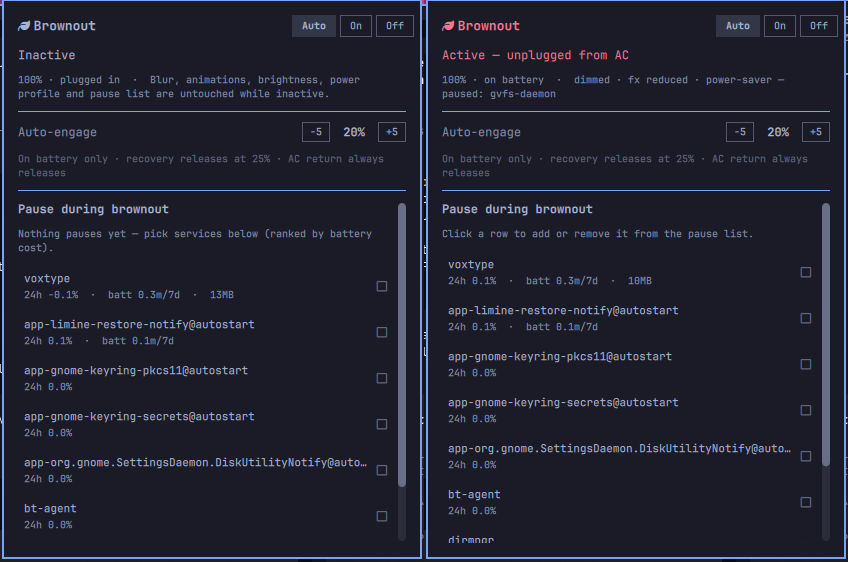

# Brownout (`fonsgaudii.brownout`)

A native [Omarchy](https://omarchy.org/) battery brownout plugin: a status-bar
leaf with an emergency popup that reacts the moment your laptop unplugs or its
battery drops low — dims the display, strips compositor eye-candy, switches to
`power-saver`, pauses user-chosen systemd services — and restores every value
exactly when power returns. Nothing pauses by default, nothing touches your
saved config, and every action lives in runtime state so a crash or botched
release can never break your setup.

<p align="center">
  
</p>

---

## Highlights

- **Two triggers, honest hysteresis** — engage on *unplug* (after a grace
  period so a cable wiggle doesn't nuke the desktop) or when the battery drops
  to your threshold (default 20%). Releases only after AC has been stably
  present for a debounce window, or — for low-battery engagements — after the
  pack recovers past the release threshold (default 25%). Low-battery
  engagements *can* release on recovery; unplug engagements never flap because
  a discharging pack is by definition "above" it.
- **Emergency profile** — brightness floor, compositor blur/shadows/animations
  and window-opacity stripping (originals saved and restored exactly), PPD
  `power-saver` profile, keyboard backlight off. Every piece degrades gracefully
  if a tool is missing.
- **Usage-ranked service pausing** — stop heavy `systemd --user` services while
  engaged and resume them on release. The popup ranks candidates by real usage
  (24 h CPU, 24 h CPU-minutes, on-battery CPU-minutes over 7 days, memory) so
  *you* decide; nothing pauses by default.
- **Controls everywhere** — bar widget popup (mode, threshold steppers, pause
  checkboxes), CLI (`brownout on/off/auto/threshold/top/…`), keybinding
  `SUPER + ALT + B`, desktop notifications engage/release, and a `doctor`
  health check.
- **Safe by construction** — system-critical user units (pipewire, dbus,
  portals, keyrings, the session itself) are blocklist-protected and can never
  be paused; engagement is suppressed while locked/idle-inhibit is active;
  every state transition is audited to a local log.
- **Testable without touching the cable** — `brownout simulate
  unplug|low|recover|clear` drives the real state machine in seconds, and a
  sandbox regression suite (`tests/sandbox.sh`) guards the daemon's semantics.

## Requirements & external dependencies

Brownout is an [Omarchy](https://omarchy.org/) shell plugin (Hyprland/Quickshell
desktop, runs the `omarchy-*` tooling). Hard requirements ship with Omarchy;
optional features degrade gracefully and are reported by `brownout doctor`.

| Dependency | Used for | If missing |
|---|---|---|
| **Omarchy** (omarchy-shell, `omarchy` CLI, `omarchy-notification-send`, hooks) | bar widget, notifications, theme-reapply hook | core; the plugin targets Omarchy systems |
| **systemd** (user units) | the watcher daemon, pausing services | core |
| **jq** | state machine + profile bookkeeping | core; cannot run without it |
| **flock** (util-linux) | single-instance locking | ships with Arch base |
| **python3** (stdlib only) | usage-history aggregation for `brownout top` / popup metrics | pause chooser shows fewer metrics |
| **brightnessctl** | display dimming / restore | dimming skipped, logged |
| **power-profiles-daemon** (`powerprofilesctl`) | `power-saver` switch | that action skipped, logged |
| **Hyprland** + `hyprctl` | blur/shadows/animations/opacity strip, refresh cap | effects skipped, logged |
| **iw** *(optional)* | Wi-Fi power save (opt-in, needs a passwordless sudo rule) | feature off (default) |

No root privileges, no PAM/polkit changes and no daemons outside
`systemd --user` are required.

## Installation

Both paths end with the plugin at
`~/.config/omarchy/plugins/fonsgaudii.brownout/`.

### Preferred: via Omarchy

```bash
omarchy plugin add https://github.com/AkinleyeMicheal/omarchy-brownout
~/.config/omarchy/plugins/fonsgaudii.brownout/install.sh
```

`omarchy plugin add` clones and validates the plugin; `install.sh` then wires up
everything a battery daemon needs beyond a bar widget:

1. a `brownout` CLI symlink into `~/.local/bin`,
2. the `fonsgaudii-brownout.service` systemd user unit (starts enabled),
3. two Omarchy hooks (`theme-set.d` reapplies the effect-strip after theme
   changes; `battery-low.d` is a one-shot engage fallback if the daemon ever
   dies),
4. a marked keybinding block in `~/.config/hypr/bindings.lua`
   (`SUPER + ALT + B` → opens the popup; re-running install never duplicates
   it, and removal strips only that block),
5. the bar widget registration, default config and post-install doctor.

### Alternative: plain git

```bash
git clone --depth 1 https://github.com/AkinleyeMicheal/omarchy-brownout \
    ~/.config/omarchy/plugins/fonsgaudii.brownout
~/.config/omarchy/plugins/fonsgaudii.brownout/install.sh
```

(Recommended for reviewers: clone anywhere and read the code before pointing
the clone at `~/.config/omarchy/plugins/`. `install.sh` is idempotent — run it
any time you want to re-sync an installed copy.)

### After installing

1. Open the popup: **`SUPER + ALT + B`**, or click the leaf in the bar's right
   section.
2. Run `brownout top` (or look at the popup list) and tick the services you
   want paused — *nothing is paused until you choose it*.
3. Tune the trigger: `brownout threshold 20` or the steppers in the popup.
4. Test risk-free: `brownout simulate unplug`, watch a full engage/restore
   cycle, then `brownout simulate clear`.

### Updating

```bash
omarchy plugin update fonsgaudii.brownout --yes
~/.config/omarchy/plugins/fonsgaudii.brownout/install.sh   # re-wire unit, hooks, binding
```

The installed dir stays a git checkout of this repo, so the standard plugin
update command works; re-running `install.sh` afterwards re-syncs the systemd
unit, hooks and keybinding.

### Removal

```bash
# from the installed plugin dir (or a git clone of this repo):
~/.config/omarchy/plugins/fonsgaudii.brownout/install.sh --remove
```

That stops and removes the user service, unlinks the CLI, removes both hooks,
strips the brownout keybinding block from your `bindings.lua`, unloads the
widget from the shell and deletes the plugin folder — while **keeping** your
chosen configuration and usage history.

Leftovers you may want for a fully clean slate:

```bash
rm -rf ~/.local/state/brownout          # history + audit log
rm    ~/.config/brownout.conf           # your saved settings
omarchy plugin remove fonsgaudii.brownout --yes   # only if the leaf still lingers in the bar
```

If you cloned the repo straight *into* the plugins directory, `--remove` deletes
that checkout too — clone it elsewhere first if you want to keep the source.

## Configuration

`~/.config/brownout.conf` (written on first install from
`brownout.conf.example`, never overwritten afterwards) is a bash-sourced
key/value file. Every key, with its default:

| Key | Default | Meaning |
|---|---|---|
| `ENGAGE_THRESHOLD` | `20` | engage while discharging at/below this % (5–50) |
| `RELEASE_THRESHOLD` | `25` | low-battery engagements release at/above this % |
| `UNPLUG_GRACE_SECONDS` | `10` | spend this long off AC before unplug engages |
| `AC_RELEASE_SECONDS` | `3` | AC must be stably back this long before release |
| `BRIGHTNESS_FLOOR_PCT` | `25` | dim to this % (only if currently brighter) |
| `DISABLE_BLUR` | `true` | strip compositor blur while engaged |
| `DISABLE_SHADOWS` | `true` | strip window shadows |
| `DISABLE_TRANSPARENCY` | `true` | force window opacity to 1.0 |
| `DISABLE_ANIMATIONS` | `true` | disable Hyprland animations |
| `USE_POWER_SAVER` | `true` | PPD `power-saver` while engaged, normal profile on AC |
| `KEYBOARD_BACKLIGHT_OFF` | `true` | keyboard backlight off (no-op without one) |
| `PAUSE_SERVICES` | `""` | space-separated `systemd --user` units to stop while engaged |
| `WIFI_POWER_SAVE` | `false` | opt-in Wi-Fi power save via `iw` |
| `WIFI_INTERFACE` | `""` | empty = autodetect the first Wi-Fi interface |
| `REFRESH_RATE_HZ` | `0` | cap built-in display refresh rate while engaged; `0` off, `auto` = lowest mode at current resolution |
| `NOTIFY` | `true` | engage/release desktop notifications |
| `POLL_SECONDS` | `5` | power-state poll cadence |
| `SAMPLE_INTERVAL_SECONDS` | `60` | usage sampler cadence |
| `HISTORY_RETENTION_DAYS` | `14` | usage history retention |
| `COMPACT_RAW_HOURS` | `48` | raw 1-minute samples kept this long, then hourly aggregates |
| `TOP_LIMIT` | `8` | rows in `brownout top` / the popup |
| `LOG_MAX_LINES` | `5000` | audit log rotation cap |

The threshold can also be changed live — `brownout threshold 35`, or the
`−5 / +5` steppers in the popup — and is persisted to the config file; the
release threshold is bumped automatically if yours would collide with it.

### The pause list

`brownout top` aggregates usage history per user service:

- `cpu_pct_24h` — average CPU% over the last 24 h
- `cpu_min_24h` — CPU-minutes over the last 24 h
- `batt_cpu_min_7d` — CPU-minutes consumed **while on battery**, last 7 days
- `mem_mb` — current memory footprint

Pop the chooser (leaf or `SUPER + ALT + B`), click rows to tick/untick, and the
pause list applies live (stopping/starting services immediately during an
engagement) and persists to `PAUSE_SERVICES`. The list scrolls with a real
scrollbar; status, mode and the threshold controls stay pinned at the top.

Services matching the never-pause blocklist are refused even by CLI:

```
pipewire  wireplumber  dbus  systemd  xdg  portal  wayland  omarchy
gnome-keyring  at-spi  dconf  hyprland  quickshell  *-brownout.service
```

## CLI

```
brownout on|off|auto       force profile / suppress auto / normal hysteresis
brownout toggle            cycle auto → on → off → auto
brownout release           one-shot rollback now, stay in auto
brownout threshold [N]     show or set the auto-engage percentage (5–50)
brownout status [--json]   current state (mode, engaged, reason, battery, …)
brownout top [--json] [--limit N] [--live]
                           rank user services by CPU/battery usage
brownout pause-toggle|pause-add|pause-remove <unit>
brownout reapply           re-apply profile actions (theme-set hook entry)
brownout simulate <unplug|plug|low|low <pct>|recover|clear>
                           drive the state machine without touching the cable
brownout doctor            environment / installation health check
brownout log [-n N]        tail the audit log
brownout fallback-engage <pct>   battery-low hook entry (daemon-dead fallback)
```

## How it works

```
on battery ──grace────────▶ ENGAGE (unplug trigger)
battery ≤ threshold ──────▶ ENGAGE (low trigger)
AC stable ≥ 3 s ──────────▶ RELEASE (restore everything)
battery ≥ release threshold ▶ RELEASE   (only for low-battery engagements)
manual release ───────────▶ RELEASE and suppress re-engage for that episode
```

The watcher is a single systemd user unit polling power state every
`POLL_SECONDS`. Engagement writes an exact snapshot of what it is about to
change, then applies the profile; release plays the snapshot back. State, log
and usage history live outside the plugin folder:

| Path | Contents |
|---|---|
| `~/.config/omarchy/plugins/fonsgaudii.brownout/` | installed plugin |
| `~/.config/brownout.conf` | your settings |
| `~/.local/state/brownout/state.json` | runtime state (mode, thresholds, engagement snapshot) |
| `~/.local/state/brownout/brownout.log` | audit log — every engage/release/action |
| `~/.local/state/brownout/usage/usage.jsonl` | usage history (compressed after 48 h) |
| `~/.config/systemd/user/fonsgaudii-brownout.service` | the watcher |
| `~/.config/omarchy/hooks/theme-set.d/theme-set-reapply.sh` | reapplies the effect strip after theme changes |
| `~/.config/omarchy/hooks/battery-low.d/battery-low-fallback.sh` | one-shot engage fallback if the daemon is dead |

All `hyprctl` calls resolve the live Hyprland IPC socket per invocation, so the
systemd service talks to the compositor correctly across restarts and logins.

## What it deliberately does *not* do

Brownout takes care only of what can be done without root, instantly reversibly,
and without fighting facilities Omarchy already provides:

- no manual CPU tweaks beyond PPD `power-saver` (no sysfs capping, core
  parking or boost toggling — PPD owns those);
- no SIGSTOP/SIGTERM freezing or killing of applications — pausing is what
  systemd user services do natively;
- no update/telemetry/network/Bluetooth blocking or rfkill tricks;
- no charge-current limits;
- no rewriting of idle/screen-off timers (use Omarchy idle settings).

## Wi-Fi power save (optional)

Off by default. `iw` requires root, so enable it only if you add a
passwordless sudo rule, e.g. via `visudo`:

```
youruser ALL=(ALL) NOPASSWD: /usr/bin/timeout 5 /usr/bin/iw *
```

then set `WIFI_POWER_SAVE=true` in `~/.config/brownout.conf`. The previous
interface setting is restored on release.

## Testing

```bash
./tests/sandbox.sh
```

Runs the real daemon inside a stubbed sandbox (11 cases, 35 assertions): grace
plus hysteresis, debounced AC release, shorter-than-debounce glitch immunity,
per-trigger recovery semantics (including the unplug-must-not-flap regression),
manual release suppression, forced modes, service pause/resume, threshold
persistence, blocklist enforcement, live config reload and removal of dead
units from the pause chooser.

For a leave-no-trace live check, the simulate harness exercises the real
desktop once: `brownout simulate unplug` → engage; `brownout simulate recover`
→ debounced release; `brownout simulate clear` → back to reality.

## Troubleshooting

```bash
brownout doctor        # checks PATH, config, unit, hooks, PPD, hyprctl IPC
brownout log -n 40     # the audit trail of every action
journalctl --user -u fonsgaudii-brownout.service -f
```

- **Widget missing after an update** — `omarchy-shell shell rescanPlugins`,
  then `omarchy restart shell`.
- **Popup shows no services** — the usage sampler needs some minutes of
  history; `brownout top` exports the same ranking.
- **PPD says the wrong profile** — if you run a TLP-like daemon alongside
  power-profiles-daemon, set `USE_POWER_SAVER=false` (the rest of the profile
  still works).
- **Engaged stuck after removing the plugin** — `brownout release` (or restore
  brightness/animations manually from `brownout log`).

## License

[MIT](LICENSE) — © 2026 fonsgaudii.
